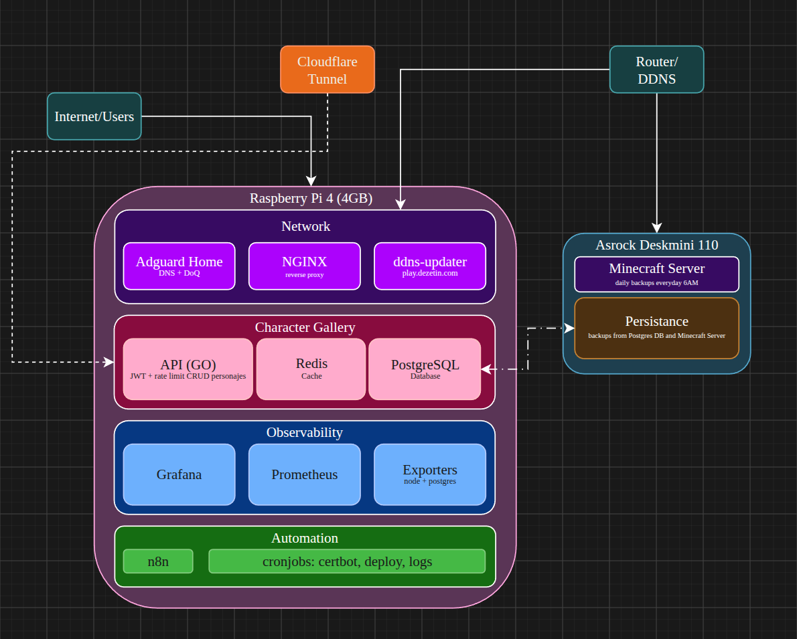
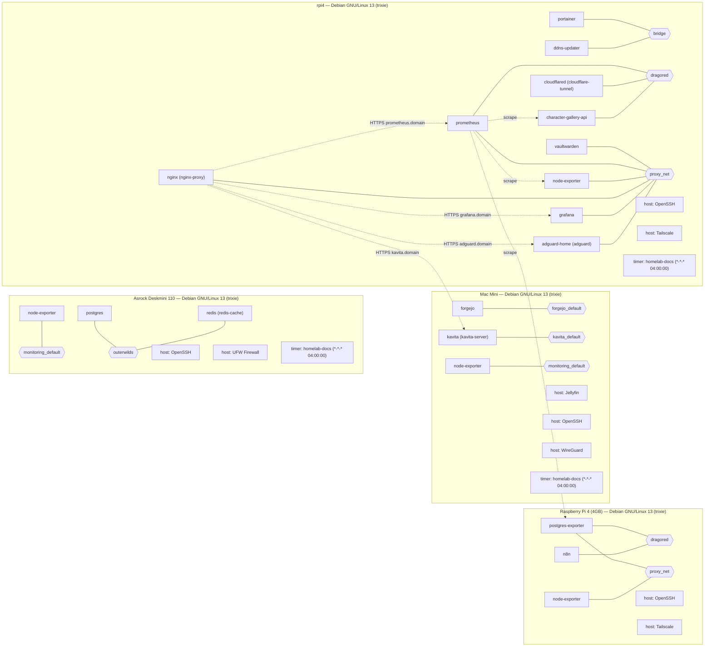

# Home Lab

Hi, I'm Diego and this is a repo explaining my home lab: three Linux nodes (a Raspberry Pi 4, an Asrock Deskmini 110, and a Mac Mini) running self-hosted services, media, Git hosting, and APIs I built and maintain.

It started as a kid's dream of running my own server, blocked at the time by my ISP's port-forwarding restrictions. Today it's my hands-on lab for networking, system administration, and self-hosting; DNS, reverse proxying, tunneling, cron/systemd automation, backups, and running services I'd otherwise pay for.

## Architecture



This lab runs across three physical Linux machines:

<!-- AUTO:NODES:START -->
| Node | Role | OS / Arch | Hardware | Host Services |
| ---- | ---- | --------- | -------- | ------------- |
| **Asrock Deskmini 110** (`deskmini`) | Backups and Minecraft | `Debian GNU/Linux 13 (trixie)` (`x86_64`) | 2c · 11.4 GB RAM · 431.5 GB disk | `Docker`, `OpenSSH`, `UFW Firewall` |
| **Mac Mini** (`mac-mini`) | Media Server | `Debian GNU/Linux 13 (trixie)` (`x86_64`) | 4c · 7.6 GB RAM · 210.3 GB disk | `Docker`, `Jellyfin`, `OpenSSH`, `WireGuard` |
| **Raspberry Pi 4 (4GB)** (`rpi-4`) | Networking node | `Debian GNU/Linux 13 (trixie)` (`aarch64`) | 4c · 3.7 GB RAM · 916.3 GB disk | `Docker`, `OpenSSH`, `Tailscale` |
| **rpi4** (`rpi4`) | Networking | `Debian GNU/Linux 13 (trixie)` (`aarch64`) | 4c · 3.7 GB RAM · 916.3 GB disk | `Docker`, `OpenSSH`, `Tailscale` |
<!-- AUTO:NODES:END -->

The workload is split by resource profile: the Pi's 4GB of RAM comfortably handles lightweight containerized services (mostly I/O-bound: DNS, proxying, APIs, observability), the Deskmini (Debian) isolates the Minecraft server and cross-server backups, and the Mac Mini (Debian) acts as a dedicated Media & Git Server (Forgejo, Jellyfin, Kavita, etc.).

### Network Design

Services are split across two isolated Docker networks by function: `dragored` for backend/data services, and `proxy_net` for anything fronted by **nginx**. Exposure is asymmetric:
- **Public**: Minecraft server (via DDNS, since friends connect directly) and select services proxied through a Cloudflare Tunnel.
- **Internal Only**: everything else (Grafana, Prometheus, Adguard's UI) is reachable via internal DNS rewrites in Adguard, only resolvable on the local network and not exposed to the internet.

This keeps the attack surface small: only those services that need exposure are exposed, and everything is not exposed by default.

<!-- AUTO:TOPOLOGY:START -->
<details>
<summary><strong>Auto-generated Multi-Node Topology Diagram (Mermaid)</strong></summary>



</details>
<!-- AUTO:TOPOLOGY:END -->

## Services

<!-- AUTO:SERVICES:START -->
| Node | Service | Image / Stack | Networks | Purpose | Docs |
| ---- | ------- | ------------- | -------- | ------- | ---- |
| `deskmini` | `node-exporter` | `prom/node-exporter` | `monitoring_default` | Host OS & hardware metrics exporter | [docs](docs/monitoring.md) |
| `deskmini` | `postgres` | `postgres:18.4-alpine3.23` | `outerwilds` | Primary relational database (API & n8n) | [compose](docker-compose/postgres/compose.yaml) |
| `deskmini` | `redis` | `redis:alpine` | `outerwilds` | In-memory cache & rate limiting | [compose](docker-compose/redis/compose.yaml) |
| `mac-mini` | `forgejo` | `codeberg.org/forgejo/forgejo:15` | `forgejo_default` | Self-hosted Git forge | — |
| `mac-mini` | `kavita` | `jvmilazz0/kavita:latest` | `kavita_default` | Self-hosted e-book & university notes reader | [docs](docs/networking.md) |
| `mac-mini` | `node-exporter` | `prom/node-exporter` | `monitoring_default` | Host OS & hardware metrics exporter | [docs](docs/monitoring.md) |
| `rpi-4` | `n8n` | `n8nio/n8n:latest` | `dragored` | Workflow automation | [compose](docker-compose/n8n/compose.yaml) |
| `rpi-4` | `node-exporter` | `prom/node-exporter` | `proxy_net` | Host OS & hardware metrics exporter | [docs](docs/monitoring.md) |
| `rpi-4` | `postgres-exporter` | `prometheuscommunity/postgres-exporter` | `proxy_net`, `dragored` | PostgreSQL metrics exporter for Prometheus | [docs](docs/monitoring.md) |
| `rpi4` | `adguard-home` | `adguard/adguardhome` | `proxy_net` | Internal DNS + ad blocking (DoQ) | [docs](docs/networking.md) |
| `rpi4` | `character-gallery-api` | `character-gallery-api:latest` | `dragored` | RPG characters CRUD API (Go) | [repo](https://github.com/dZev1/character-gallery-api) |
| `rpi4` | `cloudflared` | `cloudflare/cloudflared:latest` | `dragored` | Selective public exposure without open ports | [docs](docs/networking.md) |
| `rpi4` | `ddns-updater` | `ghcr.io/qdm12/ddns-updater` | `bridge` | Dynamic DNS updater for Minecraft server | [docs](docs/networking.md) |
| `rpi4` | `grafana` | `grafana/grafana-oss` | `proxy_net` | Dashboards & observability UI | [docs](docs/monitoring.md) |
| `rpi4` | `nginx` | `nginx:1.30.7-alpine3.24` | `proxy_net` | TLS reverse proxy for internal services | [docs](docs/networking.md) |
| `rpi4` | `node-exporter` | `prom/node-exporter` | `proxy_net` | Host OS & hardware metrics exporter | [docs](docs/monitoring.md) |
| `rpi4` | `portainer` | `portainer/portainer-ce:lts` | `bridge` | — | — |
| `rpi4` | `prometheus` | `prom/prometheus:main` | `dragored`, `proxy_net` | Time-series metrics collection | [docs](docs/monitoring.md) |
| `rpi4` | `vaultwarden` | `vaultwarden/server:testing` | `proxy_net` | — | — |
| `deskmini` | `minecraft-server` | `Fabric, Debian (systemd backups)` | `host` | Private Minecraft server for friends | [docs](docs/minecraft-server.md) |

> *Auto-generated from `nodes/*.json` and `docker-compose/*/compose.yaml` via `scripts/generate_docs.py`. See [`docs/inventory.md`](docs/inventory.md) for full hardware specs, ports, NGINX routes, Prometheus targets, and systemd timers.*
<!-- AUTO:SERVICES:END -->

## Technical Highlights

- Own API written in Go with JWT, rate limiting, cache in Redis
- Multi-node Linux setup (Raspberry Pi 4 + Deskmini + Mac Mini on Debian)
- Network segmentation per function (isolated Docker networks)
- Internal DNS vs. Selective public exposure via Cloudflare Tunnel
- Automated backups with real verification (proven restores)
- Pre-loaded world chunks to reduce CPU load on limited hardware (Celeron)
- Automated Docs-as-Code pipeline (per-node snapshot collectors + GitHub Actions)

## Project Status

**Implemented**

- Minecraft backups (with detected and corrected incident, see `docs` for more info)
- Complete system and DB Monitoring
- Dedicated Media & Git Server on Mac Mini (Debian)
- Automated multi-node inventory & topology documentation

**Pending**

- cross-server backups for Postgres (RPi → Deskmini via `pg_dump + scp`)
- Restricted SSH keys with `command=` for said backup

## General Stack

- **Debian / Linux** across all nodes
- **Docker Compose** for containerized services
- **Cloudflare Tunnel**
- Reverse Proxy with **nginx**
- Monitoring with **Grafana** & **Prometheus**
- **GitHub Actions** for automated Docs-as-Code inventory

## Repo Structure

```
nodes/ ← sanitized per-node JSON snapshots pushed automatically by each server
docker-compose/ ← sanitized copies of each service
docs/ ← detailed documentation per area + auto-generated inventory
diagrams/ ← architecture diagram
scripts/ ← node collector, sync script, systemd templates & docs generator
```
