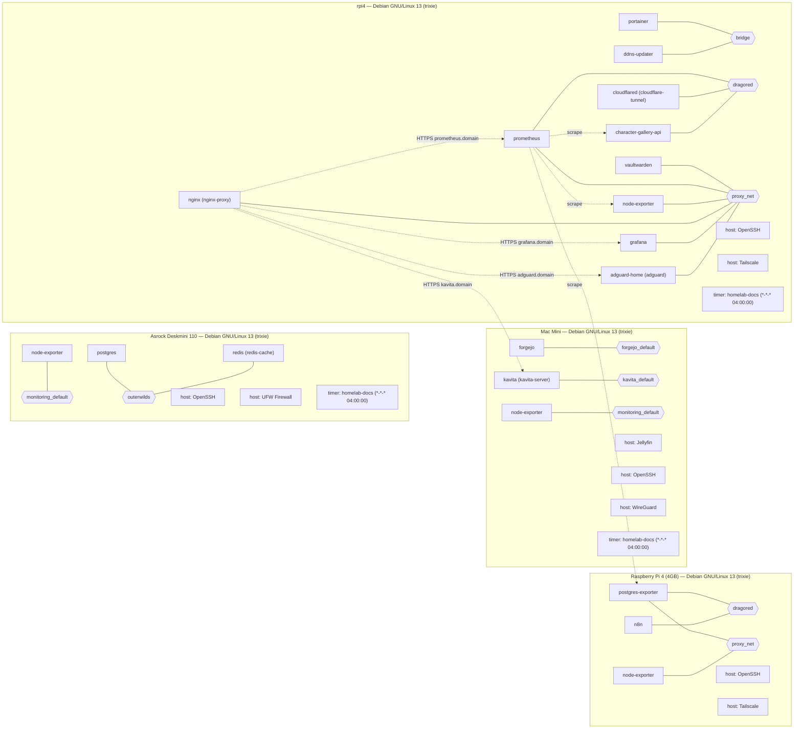

# Home Lab — Auto-Generated Inventory

> **Do not edit manually.** Generated by `scripts/generate_docs.py` from `nodes/*.json`, `docker-compose/`, and `scripts/metadata.yaml`.

## Overview

| Metric | Count |
| ------ | ----- |
| Physical Nodes | 4 (4 synced live) |
| Docker Services | 19 |
| Docker Networks | 7 (`bridge`, `dragored`, `forgejo_default`, `kavita_default`, `monitoring_default`, `outerwilds`, `proxy_net`) |
| NGINX Reverse Proxy Routes | 4 |
| Prometheus Scrape Jobs | 4 (`30s` interval) |
| Custom Systemd Timers | 3 |

## Nodes & Hardware

| Node | Role | OS / Arch | Hardware | Host Services |
| ---- | ---- | --------- | -------- | ------------- |
| **Asrock Deskmini 110** (`deskmini`) | Backups and Minecraft | `Debian GNU/Linux 13 (trixie)` (`x86_64`) | 2c · 11.4 GB RAM · 431.5 GB disk | `Docker`, `OpenSSH`, `UFW Firewall` |
| **Mac Mini** (`mac-mini`) | Media Server | `Debian GNU/Linux 13 (trixie)` (`x86_64`) | 4c · 7.6 GB RAM · 210.3 GB disk | `Docker`, `Jellyfin`, `OpenSSH`, `WireGuard` |
| **Raspberry Pi 4 (4GB)** (`rpi-4`) | Networking node | `Debian GNU/Linux 13 (trixie)` (`aarch64`) | 4c · 3.7 GB RAM · 916.3 GB disk | `Docker`, `OpenSSH`, `Tailscale` |
| **rpi4** (`rpi4`) | Networking | `Debian GNU/Linux 13 (trixie)` (`aarch64`) | 4c · 3.7 GB RAM · 916.3 GB disk | `Docker`, `OpenSSH`, `Tailscale` |

## Network & Service Topology

## Docker Services

| Node | Service | Container | Image | Networks | Exposed Ports | Restart | Source |
| ---- | ------- | --------- | ----- | -------- | ------------- | ------- | ------ |
| `deskmini` | `node-exporter` | `node-exporter` | `prom/node-exporter` | `monitoring_default` | `9100:9100/tcp` | `unless-stopped` | live (`running`) |
| `deskmini` | `postgres` | `postgres` | `postgres:18.4-alpine3.23` | `outerwilds` | `5432:5432/tcp` | `unless-stopped` | live (`running`) |
| `deskmini` | `redis` | `redis-cache` | `redis:alpine` | `outerwilds` | `6379:6379/tcp` | `unless-stopped` | live (`running`) |
| `mac-mini` | `forgejo` | `forgejo` | `codeberg.org/forgejo/forgejo:15` | `forgejo_default` | `222:22/tcp`, `3000:3000/tcp` | `always` | live (`running`) |
| `mac-mini` | `kavita` | `kavita-server` | `jvmilazz0/kavita:latest` | `kavita_default` | `5000:5000/tcp` | `unless-stopped` | live (`running`) |
| `mac-mini` | `node-exporter` | `node-exporter` | `prom/node-exporter` | `monitoring_default` | `9100:9100/tcp` | `unless-stopped` | live (`running`) |
| `rpi-4` | `n8n` | `n8n` | `n8nio/n8n:latest` | `dragored` | `5678:5678` | `unless-stopped` | [compose](../docker-compose/n8n/compose.yaml) |
| `rpi-4` | `node-exporter` | `node-exporter` | `prom/node-exporter` | `proxy_net` | — | `unless-stopped` | [compose](../docker-compose/monitoring/compose.yaml) |
| `rpi-4` | `postgres-exporter` | `postgres-exporter` | `prometheuscommunity/postgres-exporter` | `proxy_net`, `dragored` | — | `unless-stopped` | [compose](../docker-compose/monitoring/compose.yaml) |
| `rpi4` | `adguard-home` | `adguard` | `adguard/adguardhome` | `proxy_net` | `3000:3000/tcp`, `53:53/tcp`, `53:53/udp`, `784:784/udp`, `853:853/udp` | `unless-stopped` | live (`running`) |
| `rpi4` | `character-gallery-api` | `character-gallery-api` | `character-gallery-api:latest` | `dragored` | `8080:8080/tcp` | `unless-stopped` | live (`running`) |
| `rpi4` | `cloudflared` | `cloudflare-tunnel` | `cloudflare/cloudflared:latest` | `dragored` | — | `unless-stopped` | live (`running`) |
| `rpi4` | `ddns-updater` | `ddns-updater` | `ghcr.io/qdm12/ddns-updater` | `bridge` | `8050:8000/tcp` | `always` | live (`running`) |
| `rpi4` | `grafana` | `grafana` | `grafana/grafana-oss` | `proxy_net` | — | `unless-stopped` | live (`running`) |
| `rpi4` | `nginx` | `nginx-proxy` | `nginx:1.30.7-alpine3.24` | `proxy_net` | `443:443/tcp`, `443:443/udp`, `80:80/tcp` | `no` | live (`running`) |
| `rpi4` | `node-exporter` | `node-exporter` | `prom/node-exporter` | `proxy_net` | — | `unless-stopped` | live (`running`) |
| `rpi4` | `portainer` | `portainer` | `portainer/portainer-ce:lts` | `bridge` | `8000:8000/tcp`, `9443:9443/tcp` | `always` | live (`running`) |
| `rpi4` | `prometheus` | `prometheus` | `prom/prometheus:main` | `dragored`, `proxy_net` | — | `unless-stopped` | live (`running`) |
| `rpi4` | `vaultwarden` | `vaultwarden` | `vaultwarden/server:testing` | `proxy_net` | — | `always` | live (`running`) |

## NGINX Reverse Proxy Routes

| Virtual Host | Upstream Target | TLS (443) | WebSocket |
| ------------ | --------------- | --------- | --------- |
| `adguard.${Domain}` | `http://adguard:3000` | Yes | Yes |
| `grafana.${Domain}` | `http://grafana:3000` | Yes | Yes |
| `prometheus.${Domain}` | `http://prometheus:9090` | Yes | No |
| `kavita.${Domain}` | `http://kavita:5000` | Yes | Yes |

## Prometheus Scrape Targets (`scrape_interval: 30s`)

| Job | Targets |
| --- | ------- |
| `prometheus` | `localhost:9090` |
| `node-exporter` | `node-exporter:9100` |
| `character_gallery` | `character-gallery-api:8080` |
| `postgres-db` | `postgres-exporter:9187` |

## Custom Systemd Timers

| Node | Timer | Schedule | Enabled | Description |
| ---- | ----- | -------- | ------- | ----------- |
| `deskmini` | `homelab-docs` | `*-*-* 04:00:00` | `enabled` | Daily Home Lab inventory sync |
| `mac-mini` | `homelab-docs` | `*-*-* 04:00:00` | `enabled` | Daily Home Lab inventory sync |
| `rpi4` | `homelab-docs` | `*-*-* 04:00:00` | `enabled` | Daily Home Lab inventory sync |
