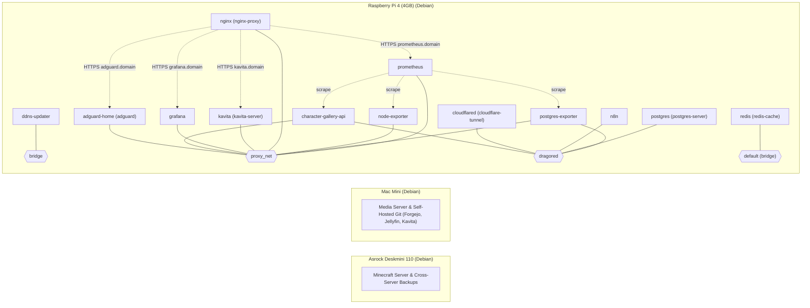

# Home Lab — Auto-Generated Inventory

> **Do not edit manually.** Generated by `scripts/generate_docs.py` from `nodes/*.json`, `docker-compose/`, and `scripts/metadata.yaml`.

## Overview

| Metric | Count |
| ------ | ----- |
| Physical Nodes | 3 (0 synced live) |
| Docker Services | 13 |
| Docker Networks | 4 (`bridge`, `default (bridge)`, `dragored`, `proxy_net`) |
| NGINX Reverse Proxy Routes | 4 |
| Prometheus Scrape Jobs | 4 (`30s` interval) |
| Custom Systemd Timers | 0 |

## Nodes & Hardware

| Node | Role | OS / Arch | Hardware | Host Services |
| ---- | ---- | --------- | -------- | ------------- |
| **Asrock Deskmini 110** (`deskmini`) | Minecraft Server & Cross-Server Backups | `Debian` *(pending sync)* | — | — |
| **Mac Mini** (`mac-mini`) | Media Server & Self-Hosted Git (Forgejo, Jellyfin, Kavita) | `Debian` *(pending sync)* | — | — |
| **Raspberry Pi 4 (4GB)** (`rpi4`) | Networking, APIs, Observability & Automation | `Debian` *(pending sync)* | — | — |

## Network & Service Topology

## Docker Services

| Node | Service | Container | Image | Networks | Exposed Ports | Restart | Source |
| ---- | ------- | --------- | ----- | -------- | ------------- | ------- | ------ |
| `rpi4` | `adguard-home` | `adguard` | `adguard/adguardhome` | `proxy_net` | `53:53/tcp`, `53:53/udp`, `784:784/udp`, `853:853/udp`, `3000:3000/tcp` | `unless-stopped` | [compose](../docker-compose/adguard/compose.yaml) |
| `rpi4` | `character-gallery-api` | `character-gallery-api` | `character-gallery-api:latest` | `dragored`, `proxy_net` | — | `unless-stopped` | [compose](../docker-compose/character-gallery/compose.yaml) |
| `rpi4` | `cloudflared` | `cloudflare-tunnel` | `cloudflare/cloudflared:latest` | `dragored` | — | `unless-stopped` | [compose](../docker-compose/cloudflared/compose.yaml) |
| `rpi4` | `ddns-updater` | `ddns-updater` | `ghcr.io/qdm12/ddns-updater` | `bridge` | `8050:8000/tcp` | `always` | [compose](../docker-compose/ddns-updater/compose.yaml) |
| `rpi4` | `grafana` | `grafana` | `grafana/grafana-oss` | `proxy_net` | — | `unless-stopped` | [compose](../docker-compose/monitoring/compose.yaml) |
| `rpi4` | `kavita` | `kavita-server` | `jvmilazz0/kavita:latest` | `proxy_net` | — | `unless-stopped` | [compose](../docker-compose/kavita/compose.yaml) |
| `rpi4` | `n8n` | `n8n` | `n8nio/n8n:latest` | `dragored` | `5678:5678` | `unless-stopped` | [compose](../docker-compose/n8n/compose.yaml) |
| `rpi4` | `nginx` | `nginx-proxy` | `nginx:stable-alpine3.24-perl` | `proxy_net` | `80:80/tcp`, `443:443/udp`, `443:443/tcp` | `no` | [compose](../docker-compose/nginx/compose.yaml) |
| `rpi4` | `node-exporter` | `node-exporter` | `prom/node-exporter` | `proxy_net` | — | `unless-stopped` | [compose](../docker-compose/monitoring/compose.yaml) |
| `rpi4` | `postgres` | `postgres-server` | `arm64v8/postgres:18.4-alpine3.23` | `dragored` | — | `unless-stopped` | [compose](../docker-compose/postgres/compose.yaml) |
| `rpi4` | `postgres-exporter` | `postgres-exporter` | `prometheuscommunity/postgres-exporter` | `proxy_net`, `dragored` | — | `unless-stopped` | [compose](../docker-compose/monitoring/compose.yaml) |
| `rpi4` | `prometheus` | `prometheus` | `prom/prometheus:main` | `proxy_net` | — | `unless-stopped` | [compose](../docker-compose/monitoring/compose.yaml) |
| `rpi4` | `redis` | `redis-cache` | `redis:alpine` | `default (bridge)` | — | `unless-stopped` | [compose](../docker-compose/redis/compose.yaml) |

## NGINX Reverse Proxy Routes

| Virtual Host | Upstream Target | TLS (443) | WebSocket |
| ------------ | --------------- | --------- | --------- |
| `adguard.${Domain}` | `http://adguard:3000` | Yes | Yes |
| `grafana.${Domain}` | `http://grafana:3000` | Yes | Yes |
| `prometheus.${Domain}` | `http://prometheus:9090` | Yes | No |
| `kavita.${Domain}` | `http://kavita:5000` | Yes | Yes |

## Prometheus Scrape Targets (`scrape_interval: 30s`)

| Job | Targets |
| --- | ------- |
| `prometheus` | `localhost:9090` |
| `node-exporter` | `node-exporter:9100` |
| `character_gallery` | `character-gallery-api:8080` |
| `postgres-db` | `postgres-exporter:9187` |
